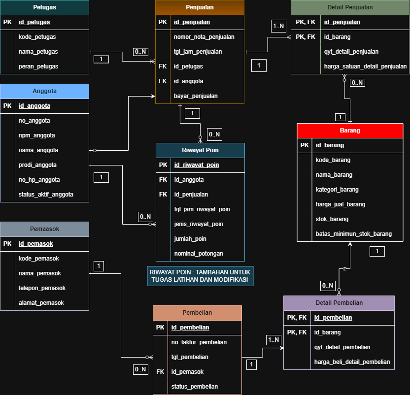
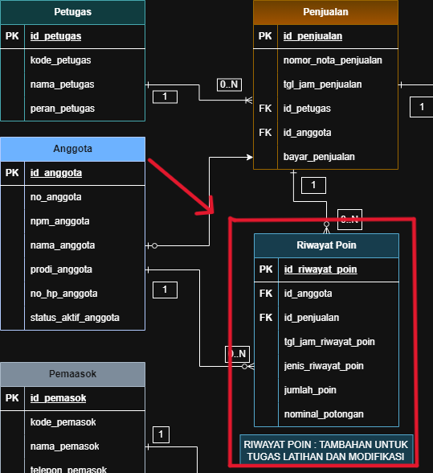
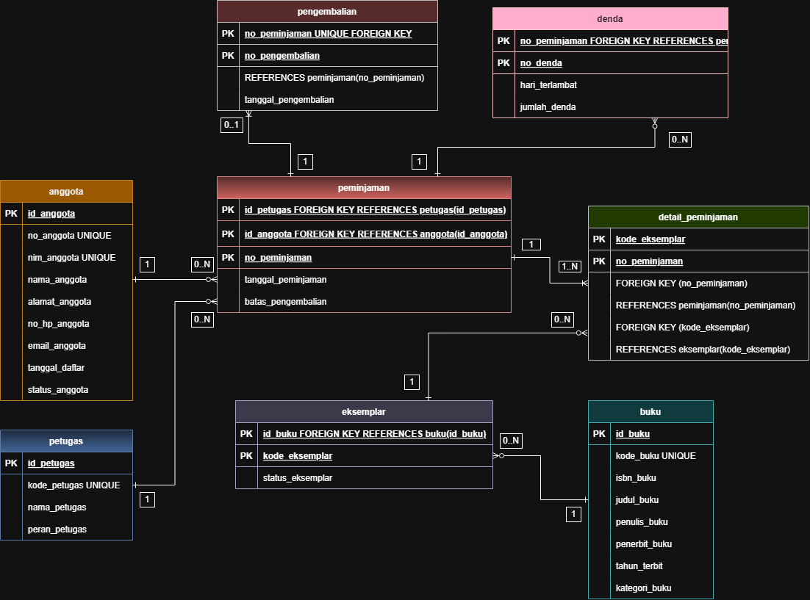
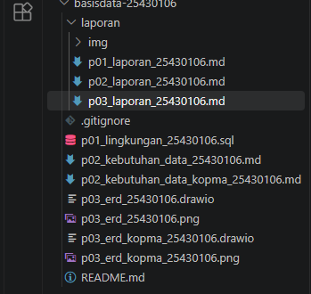
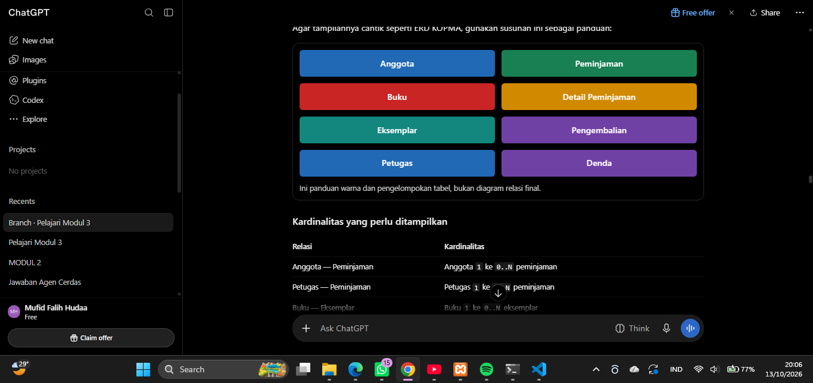

# Laporan Praktikum Basis Data - Pertemuan 03

**Nama:** Mufid Falih Hudaa 

**NIM:** 25430106  

**Kelas:** D

**Tanggal:** 13 Oktober 2026  

**Dosen:** Dedi Irawan, S.Kom., M.Kom.

## 1. Tujuan Praktikum

1. Memahami perancangan Entity Relationship Diagram (ERD) sebagai model konseptual basis data.
2. Mengidentifikasi entitas, atribut, relasi, dan kardinalitas berdasarkan kebutuhan data.
3. Memetakan kebutuhan informasi ke dalam jalur relasi pada ERD.
4. Mengevaluasi rancangan ERD berdasarkan aturan bisnis dan umpan balik pengguna.
5. Mengembangkan ERD untuk proyek mandiri Perpustakaan M MEDIA dan mendokumentasikan hasilnya menggunakan Git.

## 2. Ringkasan Dasar Teori

Entity Relationship Diagram (ERD) merupakan diagram yang menggambarkan struktur data suatu sistem melalui entitas, atribut, dan hubungan ant entitas. ERD membantu menjelaskan kebutuhan data sebelum basis data diimplementasikan menjadi tabel.

**Entitas** adalah objek yang datanya dikelola, seperti Anggota, Buku, dan Petugas. **Atribut** merupakan informasi yang dimiliki entitas, sedangkan **relasi** menunjukkan hubungan antarentitas. Kardinalitas menjelaskan jumlah keterhubungan antentitas, misalnya satu-ke-satu (1:1), satu-ke-banyak (1:N), dan banyak-ke-banyak (M:N).

Dalam perancangan ERD, setiap relasi perlu memiliki makna yang jelas dan sesuai dengan proses bisnis. Relasi banyak-ke-banyak dapat diuraikan menggunakan entitas asosiatif. Selain itu, ERD harus dapat mendukung kebutuhan informasi yang telah diidentifikasi sebelumnya. Karena itu, setiap entitas dan relasi perlu ditelusuri kembali ke proses bisnis, aturan bisnis, dan kebutuhan informasi.

## 3. Hasil Langkah Percobaan

### 3.1 Perancangan ERD Koperasi Mahasiswa (Kopma)

ERD Kopma dibuat sebagai latihan perancangan model konseptual menggunakan entitas, atribut, relasi, dan kardinalitas. Setiap hubungan perlu diberi label yang menjelaskan aktivitas bisnis yang terjadi.

*Keterangan: ERD Kopma yang menunjukkan entitas, atribut, relasi, dan kardinalitas sebagai hasil latihan pada Pertemuan 3.*

## 4. Jawaban Titik Analisis

### Titik Analisis 1 — Relasi yang Belum Memiliki Makna Jelas

Relasi yang hanya berupa garis tanpa label dapat menyulitkan pembaca memahami hubungan antentitas. Oleh karena itu, setiap relasi perlu diberi label berupa kata kerja yang sesuai dengan proses bisnis, misalnya anggota melakukan peminjaman atau buku memiliki eksemplar.

Label relasi harus dapat ditelusuri ke proses bisnis yang telah diidentifikasi sebelumnya.

### Titik Analisis 2 — Penentuan Kardinalitas

Kardinalitas ditentukan dengan menanyakan berapa banyak objek dari satu entitas yang dapat berhubungan dengan satu objek entitas lainnya.

Contohnya, satu anggota dapat mempunyai banyak transaksi peminjaman. Sebaliknya, satu transaksi peminjaman hanya berkaitan dengan satu anggota. Dengan demikian, hubungan Anggota dan Peminjaman memiliki kardinalitas satu-ke-banyak (1:N).

Penentuan kardinalitas perlu didasarkan pada aturan bisnis, bukan hanya pada posisi simbol dalam diagram.

### Titik Analisis 3 — Kemampuan ERD Menjawab Kebutuhan Informasi

ERD harus memiliki entitas dan relasi yang cukup untuk menghasilkan informasi yang dibutuhkan pengguna. Jika suatu kebutuhan informasi tidak dapat ditelusuri melalui diagram, berarti rancangan perlu dievaluasi.

Pada proyek Perpustakaan M MEDIA, kebutuhan seperti daftar anggota aktif, daftar buku, riwayat peminjaman, dan informasi keterlambatan pengembalian perlu memiliki jalur relasi yang jelas.

## 5. Hasil Latihan dan Modifikasi

### 5.1 Penambahan Kebutuhan Poin Loyalitas pada ERD Kopma

Apabila sistem Kopma memiliki fitur poin loyalitas, terdapat dua pilihan rancangan, yaitu menyimpan saldo poin sebagai atribut anggota atau membuat entitas riwayat poin.

Penyimpanan saldo sebagai atribut anggota lebih sederhana jika sistem hanya membutuhkan jumlah poin saat ini. Namun, jika sistem perlu mencatat penambahan dan penukaran poin, entitas riwayat poin lebih sesuai karena setiap perubahan dapat ditelusuri.

Untuk sistem yang memerlukan riwayat transaksi poin, entitas asosiatif atau entitas riwayat poin dapat dihubungkan dengan anggota dan transaksi yang menghasilkan perubahan poin.

### 5.2 Relasi Penjualan–Barang Tanpa Entitas Asosiatif

Jika hubungan Penjualan dan Barang digambarkan sebagai relasi banyak-ke-banyak secara langsung, data yang khusus untuk setiap barang dalam transaksi menjadi sulit direpresentasikan, misalnya kuantitas barang yang dibeli dan harga satuan pada saat transaksi.

Oleh karena itu, entitas asosiatif Detail Penjualan diperlukan untuk menyimpan rincian barang pada setiap transaksi. Pendekatan ini membuat data transaksi lebih terstruktur dan dapat dikembangkan sesuai kebutuhan sistem.

## 6. Tugas Mandiri: Milestone Proyek 3

### 6.1 Identitas Proyek

**Tema:** Perpustakaan  
**Nama Organisasi:** Perpustakaan M MEDIA

**Lingkup layanan:**

Perpustakaan M MEDIA merupakan organisasi fiktif yang menyediakan layanan pengelolaan koleksi buku, data anggota, peminjaman, dan pengembalian buku. Sistem basis data dirancang untuk membantu pencatatan data secara terstruktur sehingga informasi koleksi, anggota, transaksi peminjaman, pengembalian, dan denda dapat dikelola dengan lebih baik.

### 6.2 Entitas pada ERD Perpustakaan M MEDIA

Entitas yang digunakan dalam rancangan proyek adalah:

1. Anggota
2. Buku
3. Eksemplar
4. Petugas
5. Peminjaman
6. Detail Peminjaman
7. Pengembalian
8. Denda

Entitas Buku dipisahkan dari Eksemplar karena satu judul buku dapat memiliki beberapa eksemplar fisik. Pemisahan ini memungkinkan setiap salinan buku dikelola dan dicatat statusnya secara terpisah.

Detail Peminjaman berfungsi sebagai entitas asosiatif yang menghubungkan Peminjaman dengan Eksemplar. Pastikan entitas ini memiliki atribut tersendiri selain atribut kunci, misalnya `kondisi_saat_dipinjam`, apabila atribut tersebut sesuai dengan kebutuhan proyek dan telah dimasukkan ke diagram.

*Keterangan: ERD konseptual Perpustakaan M MEDIA yang menggambarkan struktur data dan hubungan antarentitas.*

### 6.3 Tabel Relasi dan Kardinalitas

Tabel berikut merupakan rancangan relasi awal. Pastikan setiap kardinalitas sesuai dengan aturan bisnis yang digunakan pada dokumen kebutuhan data Pertemuan 2.

| No. | Relasi | Kardinalitas | Dasar aturan bisnis |
|---|---|---|---|
| 1 | Anggota — Peminjaman | 1:N | Satu anggota dapat melakukan beberapa peminjaman. |
| 2 | Petugas — Peminjaman | 1:N | Satu petugas dapat melayani beberapa peminjaman. |
| 3 | Buku — Eksemplar | 1:N | Satu judul buku dapat memiliki beberapa eksemplar. |
| 4 | Peminjaman — Detail Peminjaman | 1:N | Satu transaksi peminjaman dapat mempunyai beberapa rincian eksemplar. |
| 5 | Eksemplar — Detail Peminjaman | 1:N | Satu eksemplar dapat tercatat pada beberapa rincian peminjaman sepanjang riwayatnya. |
| 6 | Peminjaman — Pengembalian | 1:0..1 | Satu peminjaman belum tentu sudah dikembalikan; jika sudah, tercatat satu pengembalian. |
| 7 | Peminjaman — Denda | 1:N atau 1:0..1 | Tentukan sesuai aturan apakah satu peminjaman dapat memiliki beberapa catatan denda atau maksimal satu catatan denda. |

**Catatan:** kode AB pada setiap relasi harus diisi berdasarkan nomor aturan bisnis yang benar-benar terdapat dalam dokumen kebutuhan data proyek. Jangan membuat kode AB baru tanpa memeriksa dokumen sebelumnya.

### 6.4 Penelusuran Kebutuhan Informasi ke Jalur ERD

Tabel berikut adalah contoh penelusuran awal. Sesuaikan kode KI dengan daftar kebutuhan informasi yang sudah dibuat pada Pertemuan 2.

| Kebutuhan informasi | Jalur ERD | Keterangan |
|---|---|---|
| Daftar anggota aktif | Anggota | Menggunakan data anggota dan status keanggotaannya. |
| Daftar koleksi buku | Buku → Eksemplar | Menampilkan judul buku beserta ketersediaan eksemplarnya. |
| Riwayat peminjaman anggota | Anggota → Peminjaman → Detail Peminjaman → Eksemplar → Buku | Menampilkan transaksi dan buku yang dipinjam anggota. |
| Daftar pengembalian buku | Peminjaman → Pengembalian → Detail Peminjaman → Eksemplar → Buku | Menelusuri transaksi pengembalian dan buku terkait. |
| Daftar keterlambatan dan denda | Peminjaman → Pengembalian dan/atau Denda | Menggunakan tanggal peminjaman, batas pengembalian, tanggal pengembalian, dan data denda sesuai aturan bisnis. |

Semua kebutuhan informasi dari dokumen Pertemuan 2 harus dicantumkan dalam tabel final. Jika terdapat kebutuhan informasi yang tidak dapat ditelusuri melalui ERD, diagram perlu diperiksa dan diperbaiki.

### 6.5 Catatan Tinjauan Klien

ERD perlu ditinjau oleh minimal satu teman sekelas yang berperan sebagai klien. Catat minimal dua masukan yang benar-benar diberikan dan keputusan atas masing-masing masukan.

| No. | Umpan balik teman/klien | Keputusan | Alasan |
|---|---|---|---|
| 1 | [Isi masukan pertama yang benar-benar diterima] | [Diterima/ditolak] | [Jelaskan alasan keputusan] |
| 2 | [Isi masukan kedua yang benar-benar diterima] | [Diterima/ditolak] | [Jelaskan alasan keputusan] |

Jangan mengisi bagian ini dengan umpan balik rekaan. Mintalah tinjauan teman sekelas terlebih dahulu, kemudian catat masukan dan keputusan yang sebenarnya.

### 6.6 Berkas Proyek

Berkas proyek yang disiapkan:

- `p03_erd_25430106.drawio` — sumber diagram yang dapat diedit.
- `p03_erd_25430106.png` — hasil ekspor diagram.
- `p03_laporan_25430106.md` — laporan praktikum.
- Folder `laporan/img/` — tempat menyimpan screenshot yang digunakan dalam laporan.

*Keterangan: Berkas sumber ERD, gambar hasil ekspor, dan laporan yang disiapkan untuk dikumpulkan.*

## 7. Pembahasan dan Kendala

Berdasarkan kegiatan perancangan, ERD membantu menggambarkan hubungan data yang dibutuhkan Perpustakaan M MEDIA sebelum tahap implementasi basis data. 

Entitas Detail Peminjaman berfungsi menghubungkan transaksi peminjaman dengan eksemplar yang dipinjam. Hubungan antara Peminjaman, Pengembalian, dan Denda juga perlu dirancang sesuai aturan bisnis agar informasi keterlambatan dapat ditelusuri dengan tepat.

**Kendala yang dialami:** Sulit memahami maksud tugas yang akan dikerjakan dan sulit memahami bagaimana cara kerja draw.io

**Cara mengatasi:** Menanyakan teman yanglain progress kerja dan tips mengerjakan dengan mudah.
## 8. Kesimpulan

Praktikum Pertemuan 3 memberikan pemahaman mengenai perancangan ERD, penentuan relasi dan kardinalitas, serta penelusuran kebutuhan informasi melalui struktur data.

Pada proyek Perpustakaan M MEDIA, ERD dirancang untuk menggambarkan pengelolaan anggota, koleksi buku, eksemplar, petugas, peminjaman, detail peminjaman, pengembalian, dan denda. Diagram perlu ditinjau kembali untuk memastikan seluruh kebutuhan informasi terakomodasi, kardinalitas sesuai aturan bisnis, dan entitas asosiatif memiliki atribut yang diperlukan.

Dokumentasi diagram dan laporan disimpan dalam repositori proyek agar perubahan dapat dilacak dan dilanjutkan pada pertemuan berikutnya.

## 9. Pernyataan Penggunaan AI

Dalam penyusunan laporan ini, CHATGPT digunakan sebagai alat bantu untuk menyusun kerangka tulisan, merapikan penjelasan, dan membantu memahami konsep ERD. Pemeriksaan terhadap diagram, penentuan relasi dan kardinalitas, pengisian umpan balik, serta pengambilan screenshot dilakukan dan diverifikasi berdasarkan hasil pengerjaan praktikum.

## 10. Bukti Git

Hash: fdce673 commit: p03: erd proyek (perpus)
Hash: a9a6b25 commit: p03: erd kopma

## Checklist Laporan

| No. | Komponen Laporan | Ceklis |
|---|---|:---:|
| 1 | Identitas mahasiswa sudah lengkap. | ☑ |
| 2 | Tujuan praktikum sudah ditulis. | ☑ |
| 3 | Ringkasan dasar teori sudah ditulis. | ☑ |
| 4 | Hasil langkah percobaan dilengkapi bukti. | ☑ |
| 5 | Jawaban titik analisis sudah dicantumkan. | ☑ |
| 6 | Hasil latihan dan modifikasi sudah dicantumkan. | ☑ |
| 7 | Tugas mandiri atau milestone proyek sudah dicantumkan. | ☑ |
| 8 | Pembahasan dan kendala sudah ditulis. | ☑ |
| 9 | Kesimpulan sudah ditulis. | ☑ |
| 10 | Pernyataan penggunaan AI sudah dicantumkan. | ☑ |
| 11 | Bukti Git sudah dicantumkan. | ☑ |

| No. | Kegiatan | Ceklis |
|---|---|:---:|
| 1 | Membuat ERD Kopma. | ☑ |
| 2 | Membuat ERD proyek Perpustakaan. | ☑ |
| 3 | Membuat tabel relasi dan kardinalitas. | ☑ |
| 4 | Membuat tabel penelusuran KI ke ERD. | ☑ |
| 5 | Melakukan tinjauan ERD bersama teman. | ☑ |
| 6 | Mengerjakan tugas dan latihan sesuai modul. | ☑ |
| 7 | Menyimpan dan mengumpulkan berkas sesuai ketentuan. | ☑ |
