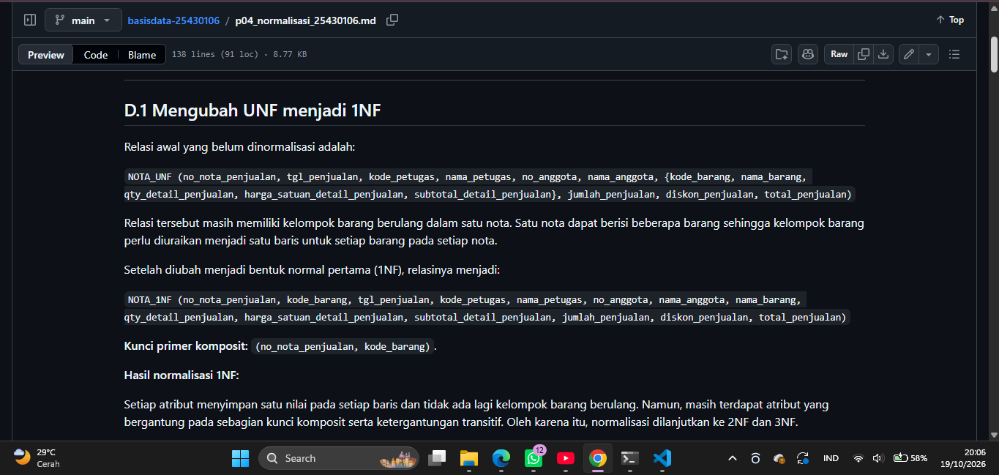
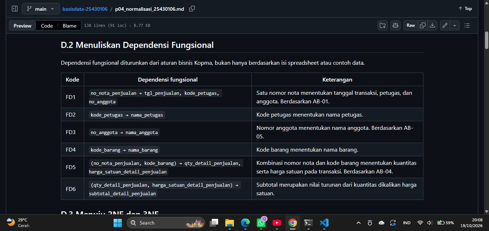
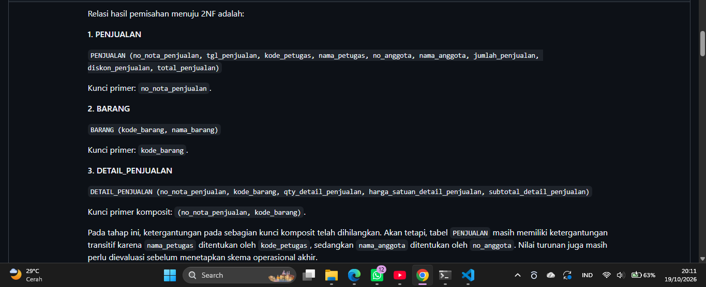
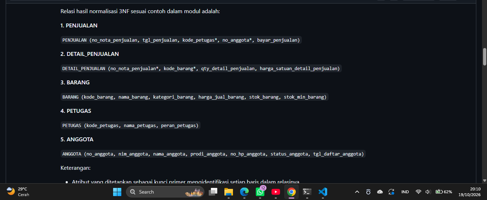
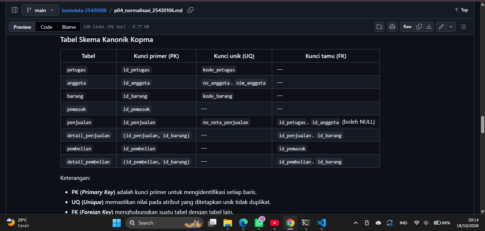
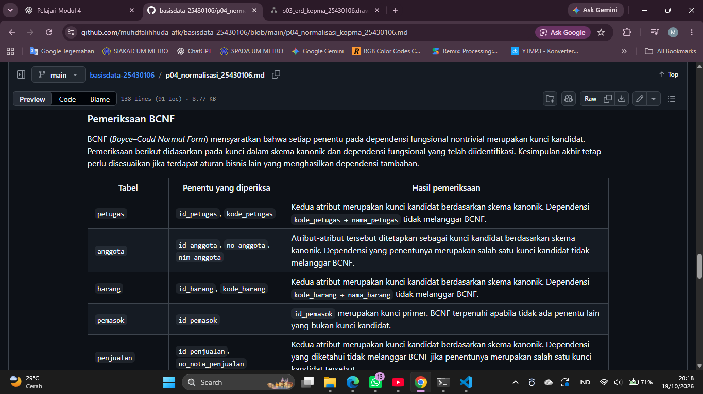
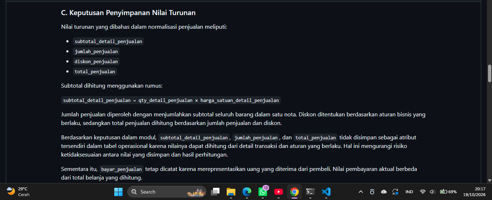
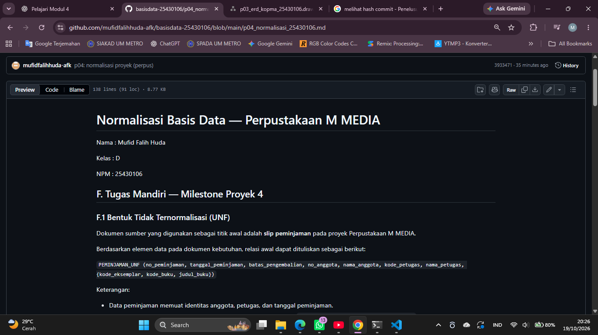

# Laporan Praktikum Basis Data - Pertemuan 04

**Nama:** Mufid Falih Huda 

**NPM:** 25430106 

**Kelas:** D  

**Tanggal:** 18 Oktober 2026

**Dosen:** Dedi Irawan, S.Kom., M.Kom.

---

## 1. Tujuan Praktikum

Tujuan praktikum pada Pertemuan 4 adalah:

1. Memahami masalah yang dapat terjadi jika data masih disimpan dalam bentuk yang belum ternormalisasi.
2. Menentukan dependensi fungsional berdasarkan aturan bisnis.
3. Melakukan normalisasi data dari bentuk tidak normal hingga 1NF, 2NF, dan 3NF.
4. Memeriksa apakah hasil normalisasi sudah memenuhi BCNF.
5. Menentukan nilai yang perlu disimpan dan nilai yang dapat dihitung kembali.
6. Menerapkan proses normalisasi pada proyek mandiri (Perpustakaan M MEDIA)

## 2. Ringkasan Dasar Teori

Normalisasi adalah proses menyusun tabel agar data lebih teratur dan mengurangi pengulangan data yang tidak diperlukan. Dengan normalisasi, perubahan data dapat dilakukan dengan lebih mudah dan risiko ketidakkonsistenan dapat dikurangi.

### 2.1 Masalah pada Data yang Belum Ternormalisasi

| Anomali | Penjelasan |
|---|---|
| Anomali penyisipan | Data baru sulit ditambahkan karena harus menunggu data lain. |
| Anomali perubahan | Informasi yang sama harus diubah di beberapa baris sehingga bisa terjadi perbedaan data. |
| Anomali penghapusan | Menghapus satu data dapat menyebabkan informasi lain ikut hilang. |

### 2.2 Tahapan Normalisasi

| Bentuk normal | Penjelasan singkat |
|---|---|
| UNF | Data masih dapat memiliki kelompok data berulang atau belum terstruktur dengan baik. |
| 1NF | Setiap kolom berisi nilai tunggal dan tidak ada kelompok data berulang dalam satu sel. |
| 2NF | Sudah memenuhi 1NF dan tidak memiliki dependensi parsial terhadap sebagian kunci gabungan. |
| 3NF | Sudah memenuhi 2NF dan tidak memiliki dependensi transitif yang melanggar 3NF. |
| BCNF | Setiap penentu pada dependensi fungsional nontrivial harus merupakan *superkey*. |

**Dependensi fungsional (FD)** menjelaskan hubungan antara atribut penentu dan atribut yang ditentukan. Contohnya, jika satu kode barang menentukan nama barang, maka kode barang menjadi penentu untuk nama barang tersebut.

## 3. Hasil Langkah Percobaan

Praktik pada bagian ini menggunakan kasus **Koperasi Mahasiswa (Kopma)**.

### 3.1 Mengubah Data UNF menjadi 1NF

Data awal perlu diperiksa untuk menemukan kelompok data berulang dan informasi yang masih tercampur. Selanjutnya, data disusun agar setiap kolom berisi satu nilai dan setiap baris dapat dibedakan dengan jelas.

| Tahap | Hasil yang diperhatikan |
|---|---|
| UNF | Data awal masih memiliki pengulangan atau kelompok data yang belum terpisah. |
| 1NF | Data disusun menjadi nilai tunggal pada setiap kolom dan kelompok berulang dipisahkan menjadi baris yang sesuai. |

**Keterangan:** Hasil akhir 1NF harus mengikuti data Kopma yang digunakan saat praktik.

### 3.2 Menentukan Dependensi Fungsional

Dependensi fungsional ditentukan berdasarkan aturan bisnis, bukan hanya dari kebetulan nilai yang terlihat pada data. Penentuan ini membantu mengetahui atribut yang bergantung pada suatu kunci.

| Contoh penentu | Atribut yang ditentukan | Makna |
|---|---|---|
| `kode_barang` | Atribut barang yang ditentukan oleh kode tersebut | Satu kode barang mengidentifikasi data barang yang sesuai. |
| `kode_petugas` | Atribut petugas yang ditentukan oleh kode tersebut | Data petugas dapat dikelola melalui kode petugas. |
| `no_nota_penjualan` | Informasi transaksi penjualan | Nomor nota mengidentifikasi transaksi penjualan. |

Contoh di atas merupakan gambaran hubungan penentu dan atribut. Daftar FD akhir harus disesuaikan dengan aturan bisnis dan atribut yang digunakan dalam praktik.

### 3.3 Mengubah 1NF menjadi 2NF

Pada tahap 2NF, atribut yang hanya bergantung pada sebagian dari kunci gabungan perlu dipisahkan ke relasi yang sesuai. Hal ini penting agar informasi barang dan transaksi tidak terus berulang pada setiap baris detail.

| Relasi | Informasi yang dikelola |
|---|---|
| `penjualan` | Informasi utama transaksi penjualan. |
| `barang` | Informasi barang. |
| `detail_penjualan` | Rincian barang yang terdapat dalam transaksi penjualan. |

Pemisahan tersebut membantu mengurangi pengulangan data barang dalam transaksi. Susunan akhir relasi tetap perlu mengikuti hasil analisis kunci dan FD dari data Kopma.

### 3.4 Mengubah 2NF menjadi 3NF

Tahap 3NF dilakukan dengan memisahkan atribut yang bergantung secara transitif pada kunci. Misalnya, jika nomor nota menentukan kode petugas, sedangkan kode petugas menentukan nama petugas, maka nama petugas lebih tepat dikelola pada relasi petugas.

| Relasi | Informasi utama |
|---|---|
| `penjualan` | Tanggal transaksi dan referensi petugas atau anggota. |
| `detail_penjualan` | Barang dan rincian pada transaksi. |
| `barang` | Informasi barang. |
| `petugas` | Informasi petugas. |
| `anggota` | Informasi anggota. |

Pemisahan ini membuat informasi anggota dan petugas tidak perlu disalin berulang kali pada setiap transaksi.

### 3.5 Mencocokkan dengan Skema Kanonik dan Memeriksa BCNF

Hasil normalisasi kemudian dibandingkan dengan skema kanonik Kopma pada Tabel 4.2 buku praktikum. Salah satu perbedaannya adalah penggunaan kunci pengganti (`id_*`) sebagai kunci primer, sedangkan kode alami seperti nomor nota tetap dapat digunakan sebagai kunci unik.

| Tabel | Kunci primer pada skema kanonik | Kunci unik atau kunci tamu |
|---|---|---|
| `petugas` | `id_petugas` | Unik: `kode_petugas` |
| `anggota` | `id_anggota` | Unik: `no_anggota`, `nim_anggota` |
| `barang` | `id_barang` | Unik: `kode_barang` |
| `pemasok` | `id_pemasok` | — |
| `penjualan` | `id_penjualan` | Unik: `no_nota_penjualan`; FK: `id_petugas`, `id_anggota` |
| `detail_penjualan` | Gabungan `id_penjualan`, `id_barang` | Keduanya menjadi FK |
| `pembelian` | `id_pembelian` | FK: `id_pemasok` |
| `detail_pembelian` | Gabungan `id_pembelian`, `id_barang` | Keduanya menjadi FK |

Pemeriksaan BCNF dilakukan dengan memeriksa dependensi fungsional pada setiap tabel. Penentu dari suatu dependensi fungsional nontrivial harus merupakan *superkey*. Karena itu, hasil pemeriksaan tidak cukup ditentukan hanya dari nama tabel atau keberadaan primary key; FD dan kunci kandidatnya juga perlu diperiksa.

### 3.6 Menentukan Nilai Turunan

Nilai turunan adalah nilai yang dapat diperoleh dari perhitungan atribut atau data lain. Pada contoh Kopma, beberapa nilai dapat dihitung dari rincian transaksi dan status anggota.

| Nilai turunan | Dasar perhitungan atau penentuan | Keputusan pada data operasional |
|---|---|---|
| Subtotal detail penjualan | Kuantitas dikalikan harga satuan | Dihitung dari data detail. |
| Jumlah penjualan | Jumlah rincian barang pada transaksi | Dihitung dari data detail. |
| Total penjualan | Perhitungan rincian transaksi dengan memperhatikan aturan yang berlaku | Tidak disimpan sebagai nilai operasional menurut contoh buku. |

Nilai yang dihitung kembali tidak perlu disimpan jika penyimpanannya berisiko menimbulkan perbedaan dengan data sumber. Keputusan ini perlu dibedakan dari penyimpanan nilai historis, yang dapat memiliki kebutuhan tersendiri.

### 3.7 Menyimpan Hasil Normalisasi

Sesuai instruksi buku, hasil tahap normalisasi Kopma disimpan dalam berkas `p04_normalisasi_kopma_25430106.md`. Perubahan kemudian di-commit dengan pesan:

`p04: normalisasi kopma` lalu aku menambahkan tugas Latihan dan Modifikasi bagian E, dan meng-commit lagi dengan `p04: normalisasi kopma (+ Latihan Modif)`

## 4. Jawaban Titik Analisis

### 4.1 Titik Analisis: Dependensi Fungsional

Dependensi fungsional ditentukan berdasarkan aturan bisnis karena data yang terlihat saat ini belum tentu menggambarkan seluruh aturan yang berlaku. Aturan bisnis membantu memastikan apakah suatu atribut benar-benar menentukan atribut lainnya.

### 4.2 Titik Analisis: Nilai Turunan

Keputusan untuk tidak menyimpan nilai turunan pada tabel operasional bertujuan agar nilai tersebut dapat dihitung dari data sumber sehingga risiko ketidaksesuaian dapat dikurangi. Untuk data historis, keputusan penyimpanan dapat berbeda apabila nilai yang tercatat harus mempertahankan keadaan pada saat transaksi berlangsung.

### 4.3 Titik Analisis: Informasi Pemasok

Kolom `pemasok_brg` pada data lama tidak perlu dipertahankan sebagai nama pemasok di tabel barang. Informasi pemasok dikelola pada tabel `pemasok`, sedangkan hubungan pembelian terhadap pemasok dicatat melalui `id_pemasok` pada tabel `pembelian`. Pemisahan ini membantu menghindari pengulangan informasi pemasok dan memudahkan pengelolaan datanya.

## 5. Hasil Latihan dan Modifikasi

### 5.1 Mencatat Beberapa Nomor Telepon Pemasok

Jika satu pemasok dapat memiliki beberapa nomor telepon, nomor telepon sebaiknya dipisahkan ke relasi tersendiri agar satu kolom tidak berisi banyak nilai.

Contoh rancangan relasi:

| Relasi | Atribut |
|---|---|
| `pemasok` | `id_pemasok`, atribut identitas pemasok |
| `telepon_pemasok` | `id_pemasok`, `no_telepon` |

`id_pemasok` pada `telepon_pemasok` menjadi kunci tamu yang mengacu ke tabel `pemasok`. Dengan rancangan ini, satu pemasok dapat memiliki beberapa nomor telepon tanpa menambah kolom telepon berulang pada tabel pemasok.

### 5.2 Anomali jika Nama Anggota Disimpan pada Penjualan

Jika `nama_anggota` disimpan langsung pada tabel `penjualan`, nama anggota yang sama dapat tercatat pada banyak transaksi. Ketika nama anggota berubah, setiap transaksi yang menyimpan nama tersebut berpotensi harus diperbarui.

| Kondisi | Dampak |
|---|---|
| Nama anggota disalin ke banyak transaksi | Terjadi pengulangan data. |
| Nama hanya diubah pada sebagian transaksi | Informasi nama menjadi tidak konsisten. |
| Nama anggota dikelola di tabel `anggota` | Data identitas lebih terpusat dan transaksi cukup menyimpan referensi anggota. |

Oleh karena itu, tabel `penjualan` sebaiknya menyimpan referensi anggota, sedangkan identitas anggota dikelola pada tabel `anggota`.

## 6. Tugas Mandiri: Milestone Proyek 4

### 6.1 Objek Proyek

Proyek mandiri yang digunakan adalah **Perpustakaan M MEDIA**, yaitu sistem untuk mengelola data anggota, buku, eksemplar, peminjaman, pengembalian, dan denda.

### 6.2 Data Awal dan Dependensi Fungsional

Dokumen kebutuhan data dari Pertemuan 2 digunakan sebagai titik awal normalisasi. Dependensi fungsional ditentukan berdasarkan atribut dan aturan bisnis yang tercantum pada dokumen tersebut.

| Aturan | Penerapan dalam normalisasi |
|---|---|
| AB-01: Nomor anggota harus unik | `no_anggota` menjadi penentu identitas anggota. |
| AB-02: Hanya anggota aktif yang dapat meminjam | Status anggota menjadi syarat proses peminjaman. |
| AB-03: Maksimal 9 buku per transaksi | Jumlah buku dalam satu transaksi harus diperiksa. |
| AB-04: Satu eksemplar tidak dapat dipinjam dua anggota secara bersamaan | Status peminjaman eksemplar harus dikelola secara konsisten. |
| AB-06: Setiap peminjaman memiliki batas pengembalian | Data peminjaman perlu mencatat batas kembali. |
| AB-07: Denda Rp7.000 per hari keterlambatan | Denda dapat dihitung dari jumlah hari terlambat. |
| AB-08: Pengembalian harus merujuk pada peminjaman yang tercatat | Data pengembalian perlu terhubung dengan data peminjaman. |

Aturan di atas menjadi dasar analisis. Daftar FD lengkap dan tahap normalisasi harus dituliskan berdasarkan atribut serta kunci yang benar-benar digunakan pada dokumen proyek.

### 6.3 Hasil Relasi Proyek

Berikut ringkasan relasi yang digunakan dalam rancangan proyek perpustakaan.

| Relasi | Fungsi |
|---|---|
| `anggota` | Menyimpan identitas dan status anggota. |
| `buku` | Menyimpan informasi judul dan identitas buku. |
| `eksemplar` | Mencatat setiap salinan fisik buku. |
| `petugas` | Menyimpan identitas petugas. |
| `peminjaman` | Mencatat transaksi peminjaman. |
| `detail_peminjaman` | Menghubungkan transaksi peminjaman dengan eksemplar yang dipinjam. |
| `pengembalian` | Mencatat pengembalian yang mengacu pada peminjaman. |
| `denda` | Mencatat denda yang terkait dengan peminjaman. |

Pemisahan tabel `buku` dan `eksemplar` diperlukan karena satu judul buku dapat memiliki beberapa salinan fisik. Dengan demikian, ketersediaan setiap eksemplar dapat dikelola tanpa mencampuradukkan data judul buku dengan kondisi salinannya.

### 6.4 Nilai Turunan dan Catatan Normalisasi

| Nilai atau aturan | Pertimbangan |
|---|---|
| Jumlah hari keterlambatan | Dapat dihitung dari tanggal yang relevan sesuai aturan pengembalian. |
| Jumlah denda | Mengacu pada aturan Rp7.000 per hari terlambat. |
| Status ketersediaan eksemplar | Harus konsisten dengan kondisi peminjaman dan pengembalian. |
| Batas maksimal 9 buku | Merupakan aturan bisnis yang perlu diperiksa pada transaksi peminjaman. |

Normalisasi proyek perlu diperiksa kembali terhadap ERD dan aturan bisnis yang telah dibuat sebelumnya. Jika tidak ada perubahan yang diperlukan, jangan mengubah ERD hanya untuk menambah bagian laporan. Jika terdapat perubahan, catat bagian yang berubah beserta alasannya.

## 7. Pembahasan dan Kendala

Berdasarkan praktikum ini, saya memahami bahwa normalisasi bukan hanya memisahkan tabel, tetapi juga memeriksa hubungan antaratribut dan aturan bisnis yang berlaku. Pemisahan data anggota, petugas, barang, dan transaksi membantu mengurangi pengulangan data serta memudahkan proses perubahan.

Hal yang perlu diperhatikan adalah penentuan kunci dan dependensi fungsional. Jika penentunya belum tepat, hasil normalisasi juga bisa kurang sesuai. Pada proyek perpustakaan, pemisahan data buku dan eksemplar juga penting karena satu judul dapat memiliki beberapa salinan fisik dengan kondisi yang berbeda.

**Kendala yang saya alami:** [Isi sesuai kendala yang benar-benar dialami saat praktik, misalnya menentukan FD, membedakan dependensi parsial dan transitif, atau memeriksa BCNF.]

## 8. Kesimpulan

Melalui praktikum Pertemuan 4, saya mempelajari tahapan normalisasi dari UNF hingga 3NF serta pemeriksaan BCNF. Saya juga memahami bahwa dependensi fungsional perlu ditentukan berdasarkan aturan bisnis, bukan hanya dari data yang terlihat.

Pada proyek Perpustakaan M MEDIA, normalisasi membantu memisahkan informasi anggota, buku, eksemplar, transaksi peminjaman, pengembalian, dan denda sesuai fungsinya. Hasil akhirnya perlu tetap diperiksa berdasarkan kebutuhan informasi dan aturan bisnis proyek.

## 9. Pernyataan Penggunaan AI

Saya menggunakan AI CHAT gpt sebagai alat bantu untuk merapikan susunan laporan, memahami istilah normalisasi, dan memperbaiki bahasa penulisan. Isi akhir laporan, hasil praktik, screenshot, dan bukti Git perlu saya periksa kembali agar sesuai dengan pekerjaan yang benar-benar dilakukan serta ketentuan buku praktikum.

## 10. Bukti Git

| Bukti | Keterangan |
|---|---|
| Repositori | `basisdata-25430106` |
| Berkas normalisasi Kopma | `p04_normalisasi_kopma_25430106.md`, `p04_normalisasi_25430106.md` |
| Pesan commit | `p04: normalisasi kopma (+ Latihan Modif)`, `p04: normalisasi proyek (perpus)` |
| Hash commit | 655aa78, 3933471 |
| Tautan repositori | https://github.com/mufidfalihhuda-afk/basisdata-25430106 |

## Checklist Umum Laporan

| Cek | Butir | Yang Harus Ada |
|---|---|---|
| ☑ | Tujuan Praktikum | Tujuan ditulis sesuai materi pertemuan |
| ☑ | Ringkasan Dasar Teori | Ringkasan materi normalisasi |
| ☑ | Hasil Langkah Percobaan | Tangkapan layar dan keterangan langkah praktikum |
| ☑ | Titik Analisis | Semua titik analisis dijawab dengan alasan |
| ☑ | Latihan (E) | Dokumen atau skrip hasil latihan beserta bukti pengerjaan |
| ☑ | Tugas Mandiri (F) | Berkas, bukti, dan penjelasan keputusan desain proyek |
| ☑ | Pembahasan dan Kendala | Galat yang ditemui, cara membaca, dan cara mengatasinya |
| ☑ | Kesimpulan | Dua sampai empat kalimat dengan bahasa sendiri |
| ☑ | Pernyataan Penggunaan AI | Alat yang digunakan, untuk apa, dan bagian yang dibantu. Tulis “tidak menggunakan” jika memang tidak menggunakan |
| ☑ | Bukti Git | Tautan repositori dan hash commit pertemuan ini dengan pesan commit `p04: ...` |
| ☑ | Keaslian | Tangkapan layar memperlihatkan akun ber-NIM dan jam sistem; nama objek memuat NIM atau inisial |

## Checklist Khusus Laporan Pertemuan 4

| Cek | Jenis | Yang Harus Ada |
|---|---|---|
| ☑ | Berkas Wajib | Berkas `p04_normalisasi_25430106.md` untuk proyek |
| ☑ | Bukti Tangkapan Layar | Tabel tahapan normalisasi UNF → 1NF → 2NF → 3NF |
| ☑ | Analisis Wajib | Daftar dependensi fungsional serta keputusan menyimpan atau menghitung nilai turunan beserta alasannya |

