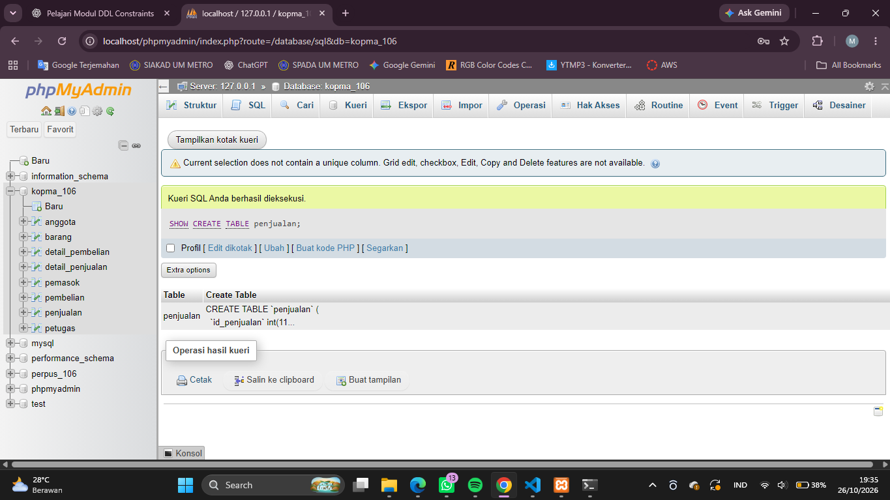
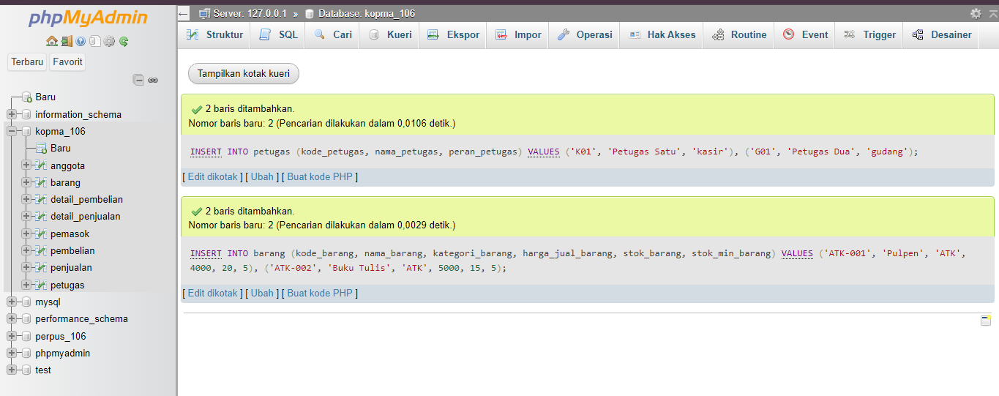

# Laporan Praktikum Basis Data - Pertemuan 05
**Nama** : Mufid Falih Huda

**NPM** : 25430106

**Kelas** : D

**Tanggal** : 27 Oktober 2026

**Dosen Pengampu** : Dedi Irawan, S.Kom., M.Kom.

## 1. Tujuan Praktikum

Praktikum ini bertujuan untuk memahami cara membuat struktur tabel menggunakan DDL (*Data Definition Language*), menerapkan kunci primer dan kunci tamu, serta menambahkan constraint untuk menjaga agar data yang disimpan tetap sesuai aturan.

Selain itu, praktikum ini bertujuan untuk menerapkan materi tersebut pada proyek **Perpustakaan M MEDIA**, membuat ERD fisik berdasarkan struktur tabel, dan membandingkan rancangan ERD dengan implementasi basis data.

## 2. Ringkasan Dasar Teori

DDL merupakan bagian dari SQL yang digunakan untuk membuat dan mengatur struktur basis data, seperti menggunakan perintah `CREATE`, `ALTER`, dan `DROP`. Dalam pembuatan tabel, `PRIMARY KEY` digunakan sebagai identitas unik setiap data, sedangkan `FOREIGN KEY` menghubungkan data antartabel dan menjaga integritas referensial.

Constraint seperti `UNIQUE`, `NOT NULL`, dan `CHECK` digunakan untuk membatasi data agar sesuai ketentuan. Constraint perlu diberi nama yang jelas supaya lebih mudah dikenali ketika terjadi kesalahan. Pemilihan tipe data juga perlu disesuaikan dengan isi atribut agar data tersimpan dengan tepat.

Pada proyek Perpustakaan M MEDIA, struktur tabel dan constraint dibuat berdasarkan dokumen kebutuhan data yang telah disusun pada pertemuan sebelumnya.

## 3. Hasil Langkah Percobaan (tangkapan layar + keterangan)

Bagian ini memuat bukti pelaksanaan praktikum. Masukkan tangkapan layar sesuai hasil yang benar-benar diperoleh selama praktikum.

### 3.1 Pembuatan dan pemeriksaan struktur tabel

Kode untuk membuat tabel telah disimpan didalam file `p05_ddl_kopma_25430106.sql`



**Gambar 2. Pemeriksaan struktur tabel**


Keterangan: Tangkapan layar hasil perintah `SHOW CREATE TABLE` untuk memeriksa struktur tabel, kunci, dan constraint yang telah dibuat.

Contoh perintah yang digunakan:

```sql
SHOW CREATE TABLE anggota;
SHOW CREATE TABLE buku;
SHOW CREATE TABLE eksemplar;
SHOW CREATE TABLE peminjaman;
SHOW CREATE TABLE detail_peminjaman;
SHOW CREATE TABLE pengembalian;
SHOW CREATE TABLE denda;
```

Perintah tersebut digunakan untuk memeriksa struktur tabel yang sudah dibuat. Sesuaikan daftar tabel dengan hasil implementasi yang sebenarnya.

### 3.2 Penambahan Data Contoh dan Pengujian Constraint

Pada tahap ini, dilakukan penambahan dua data contoh anggota ke dalam tabel `anggota`. Setelah data berhasil dimasukkan, dilakukan pengujian constraint untuk memastikan aturan pada database berjalan sesuai dengan rancangan.

**a. Menambahkan Dua Data Contoh**



**Gambar 3 Penambahan Dua Data Contoh Anggota**

**b. Pengujian Constraint UNIQUE**

Pengujian dilakukan dengan memasukkan nomor anggota `AG-001` yang sudah digunakan sebelumnya.

```sql
INSERT INTO anggota
    (no_anggota, nim_anggota, nama_anggota,
     tanggal_daftar, status_anggota)
VALUES
    ('AG-001', '25430103', 'Budi Santoso',
     '2026-10-02', 'aktif');
```

Data tersebut seharusnya ditolak karena `no_anggota` harus unik dan tidak boleh digunakan oleh lebih dari satu anggota.

**Gambar 4 Pengujian Constraint UNIQUE**

*Masukkan tangkapan layar pesan kesalahan yang muncul saat data duplikat ditambahkan.*

**c. Pengujian Constraint FOREIGN KEY**

Pengujian dilakukan dengan mencoba menambahkan data eksemplar yang merujuk pada `id_buku` yang tidak tersedia pada tabel `buku`.

```sql
INSERT INTO eksemplar
    (kode_eksemplar, id_buku, status_eksemplar)
VALUES
    ('EKS-UJI-001', 999999, 'tersedia');
```

Data tersebut seharusnya ditolak apabila `id_buku` tidak ditemukan pada tabel `buku`. Hal ini menunjukkan bahwa constraint `FOREIGN KEY` menjaga hubungan antar tabel agar tetap valid.

**Gambar 3.2.3 Pengujian Constraint FOREIGN KEY**

*Masukkan tangkapan layar pesan kesalahan saat memasukkan ID buku yang tidak tersedia.*

**d. Pengujian Constraint CHECK**

Pengujian dilakukan dengan mencoba memasukkan nilai denda negatif. Gunakan nomor pengembalian yang benar-benar tersedia pada tabel `pengembalian`.

```sql
INSERT INTO denda
    (no_pengembalian, hari_terlambat, jumlah_denda)
VALUES
    ([NO_PENGEMBALIAN_VALID], 0, -1000);
```

Ganti `[NO_PENGEMBALIAN_VALID]` dengan nomor pengembalian yang tersedia di database. Data tersebut seharusnya ditolak apabila constraint `CHECK` pada `jumlah_denda` berjalan dengan benar.

**Gambar 3.2.4 Pengujian Constraint CHECK**

*Masukkan tangkapan layar pesan kesalahan saat nilai denda negatif dimasukkan.*

Berdasarkan pengujian tersebut, constraint `UNIQUE`, `FOREIGN KEY`, dan `CHECK` digunakan untuk menjaga keunikan data, keabsahan hubungan antar tabel, serta validitas nilai yang disimpan dalam database. Hasil pengujian harus disesuaikan dengan pesan yang benar-benar muncul saat perintah SQL dijalankan.
## 4. Jawaban Titik Analisis

### 4.1 Mengapa constraint diperlukan?

Constraint diperlukan untuk menjaga agar data yang masuk ke basis data tidak bertentangan dengan aturan yang telah ditentukan. Contohnya, `UNIQUE` digunakan untuk mencegah nomor anggota yang sama, `FOREIGN KEY` menjaga hubungan antartabel, dan `CHECK` membatasi nilai yang tidak sesuai ketentuan.

Tanpa constraint yang tepat, data yang salah bisa tersimpan dan menyebabkan hasil laporan menjadi tidak akurat.

### 4.2 Apa fungsi PRIMARY KEY dan FOREIGN KEY?

`PRIMARY KEY` digunakan untuk membedakan setiap baris data dalam sebuah tabel. Sementara itu, `FOREIGN KEY` digunakan untuk menghubungkan suatu tabel dengan tabel lain.

Pada proyek Perpustakaan M MEDIA, `id_anggota` pada tabel peminjaman menjadi kunci tamu yang mengacu pada tabel anggota. Dengan demikian, peminjaman dapat dikaitkan dengan anggota yang tercatat.

### 4.3 Mengapa nama constraint harus dibuat jelas?

Nama constraint yang jelas memudahkan proses pemeriksaan dan pencarian sumber kesalahan. Sesuai pedoman Modul 5, penamaan constraint menggunakan pola `pk_`, `fk_`, `uq_`, atau `ck_`, diikuti nama tabel yang sesuai.

Komentar constraint juga perlu mengacu pada kode aturan bisnis dari dokumen kebutuhan data, seperti AB-01 sampai AB-08.

### 4.4 Apakah semua aturan bisnis bisa diterapkan dengan CHECK?

Tidak semua aturan bisnis dapat diterapkan dengan `CHECK`. Constraint tersebut cocok untuk memeriksa nilai pada baris, misalnya memastikan jumlah denda tidak negatif atau tanggal pengembalian tidak lebih awal dari tanggal peminjaman.

Namun, aturan yang bergantung pada jumlah baris dalam suatu transaksi, seperti maksimal sembilan buku dalam satu peminjaman, tidak dapat dijamin hanya menggunakan `CHECK`. Aturan tersebut memerlukan mekanisme tambahan yang akan dibahas pada materi berikutnya.

## 5. Hasil Latihan dan Modifikasi

### 5.1 Penerapan constraint pada proyek perpustakaan

Pada proyek Perpustakaan M MEDIA, struktur tabel dirancang untuk mengelola data anggota, buku, eksemplar, petugas, peminjaman, detail peminjaman, pengembalian, dan denda.

Constraint yang diterapkan disesuaikan dengan kebutuhan setiap tabel, antara lain:

| Constraint | Penerapan | Tujuan |
|---|---|---|
| `PRIMARY KEY` | Setiap tabel | Membedakan setiap data |
| `FOREIGN KEY` | Tabel yang berelasi | Menjaga hubungan antartabel |
| `UNIQUE` | Nomor anggota dan kode unik lainnya | Mencegah nilai unik digunakan berulang |
| `NOT NULL` | Atribut yang wajib diisi | Mencegah data wajib kosong |
| `CHECK` | Tanggal dan nilai numerik tertentu | Membatasi nilai yang tidak sesuai |

### 5.2 Penyesuaian struktur pengembalian

Pada proyek ini, satu transaksi peminjaman dapat dikembalikan secara bertahap. Oleh karena itu, data pengembalian perlu dikaitkan dengan detail peminjaman yang menunjukkan eksemplar tertentu.

Penyesuaian tersebut membantu sistem mencatat pengembalian setiap eksemplar secara terpisah. Data denda juga dapat dikaitkan dengan catatan pengembalian sehingga perhitungan keterlambatan lebih mudah ditelusuri.

Penyesuaian ini merupakan keputusan desain proyek dan perlu dicocokkan kembali dengan ERD serta skrip DDL yang benar-benar digunakan.

## 6. Tugas Mandiri: Milestone Proyek 05

### 6.1 Identitas proyek

**Tema:** Perpustakaan  
**Nama organisasi:** Perpustakaan M MEDIA  
**Nama basis data:** `perpus_106`

Perpustakaan M MEDIA merupakan organisasi fiktif yang menyediakan layanan pengelolaan koleksi buku, data anggota, peminjaman, pengembalian, dan denda. Basis data dibuat untuk membantu petugas mengelola data secara terstruktur dan memudahkan pengelola memperoleh informasi yang dibutuhkan.

### 6.2 Implementasi DDL

Berkas utama yang dibuat untuk milestone ini adalah:

`p05_ddl_25430106.sql`

Berkas tersebut berisi perintah untuk membuat struktur basis data dan tabel, menentukan kunci primer dan kunci tamu, serta menerapkan constraint sesuai kebutuhan proyek.

Skrip harus dapat dijalankan kembali dari kondisi basis data kosong. Untuk itu, urutan penghapusan tabel perlu memperhatikan hubungan antartabel, yaitu tabel anak dihapus sebelum tabel induk.

### 6.3 Penerapan aturan bisnis

| Kode | Aturan bisnis | Penerapan pada struktur |
|---|---|---|
| AB-01 | Nomor anggota harus unik | `UNIQUE` pada nomor anggota |
| AB-02 | Hanya anggota aktif yang dapat meminjam | Memerlukan validasi status anggota ketika transaksi dibuat |
| AB-03 | Maksimal 9 buku dalam satu transaksi | Memerlukan validasi jumlah detail peminjaman; tidak cukup dengan `CHECK` biasa |
| AB-04 | Satu eksemplar tidak boleh dipinjam dua anggota sekaligus | Memerlukan pemeriksaan status dan transaksi peminjaman |
| AB-05 | Eksemplar yang tidak tersedia tidak dapat dipinjam | Status eksemplar perlu divalidasi saat peminjaman |
| AB-06 | Setiap peminjaman memiliki batas pengembalian | Atribut batas pengembalian wajib diisi |
| AB-07 | Keterlambatan dikenakan denda Rp7.000 per hari | Nilai denda perlu dihitung atau divalidasi sesuai jumlah hari terlambat |
| AB-08 | Pengembalian harus mengacu pada peminjaman yang tercatat | `FOREIGN KEY` pada relasi pengembalian |

Aturan AB-02, AB-03, AB-04, AB-05, dan perhitungan AB-07 tidak semuanya dapat dijamin oleh constraint sederhana. Aturan tersebut membutuhkan validasi transaksi atau mekanisme tambahan. Hal ini perlu diperhatikan saat pengembangan proyek pada pertemuan berikutnya.

### 6.4 ERD fisik

Berkas ERD fisik yang disiapkan adalah:

- `p05_erd_fisik_25430106.png`
- Berkas sumber ERD yang dapat diedit.

ERD fisik perlu menampilkan tabel beserta atribut, tipe data, kunci primer, kunci tamu, constraint yang relevan, dan hubungan antartabel. Diagram juga harus sesuai dengan struktur DDL yang dijalankan.


Keterangan: Masukkan gambar ERD fisik yang benar-benar sudah dibuat. Pastikan nama tabel, atribut, dan hubungan pada diagram sesuai dengan skrip DDL.

### 6.5 Pemetaan tipe data

Pemilihan tipe data disesuaikan dengan karakteristik masing-masing atribut.

| Atribut | Tipe data yang direncanakan | Alasan |
|---|---|---|
| ID dan nomor transaksi | `INT UNSIGNED` | Menyimpan bilangan bulat positif |
| Kode anggota dan kode eksemplar | `VARCHAR` | Menyimpan kode yang dapat mengandung huruf dan angka |
| Nama dan judul buku | `VARCHAR` | Menyimpan teks dengan panjang yang bervariasi |
| Alamat | `TEXT` | Menampung teks yang relatif panjang |
| Tanggal peminjaman dan pengembalian | `DATE` | Menyimpan tanggal |
| Tahun terbit | `YEAR` | Menyimpan tahun terbit |
| Hari terlambat | `INT UNSIGNED` | Menyimpan jumlah hari yang tidak negatif |
| Jumlah denda | `DECIMAL(12,2)` | Menyimpan nilai uang dengan pecahan desimal |

Tipe data pada tabel ini merupakan rancangan yang digunakan untuk menjelaskan pemilihan tipe data. Nama atribut dan tipe data akhir harus mengikuti skrip DDL yang benar-benar dibuat.

### 6.6 Perbandingan ERD dengan implementasi

Perbandingan dilakukan dengan memeriksa apakah setiap entitas pada ERD sudah menjadi tabel, apakah atributnya sudah sesuai, dan apakah hubungan antartabel sudah diterapkan melalui kunci tamu.

Hal yang diperiksa meliputi:

1. Setiap tabel memiliki kunci primer.
2. Hubungan pada ERD sudah diterapkan sebagai `FOREIGN KEY`.
3. Atribut unik sudah memiliki constraint `UNIQUE` jika diperlukan.
4. Constraint yang dibuat sesuai dengan aturan bisnis AB-01 sampai AB-08.
5. Struktur ERD fisik sama dengan struktur tabel yang dihasilkan oleh DDL.

Jika ditemukan perbedaan, diagram atau skrip perlu diperbaiki agar keduanya konsisten.

## 7. Pembahasan dan Kendala

Pembuatan DDL tidak hanya berfokus pada keberhasilan membuat tabel, tetapi juga pada ketepatan hubungan dan aturan yang diterapkan. Setiap kunci tamu harus mengacu pada kolom yang sesuai pada tabel induk. Jika tipe data atau atribut yang diacu tidak cocok, pembuatan relasi dapat gagal.

Kendala lainnya adalah membedakan aturan yang bisa diterapkan langsung melalui constraint dengan aturan yang membutuhkan pemeriksaan transaksi. Misalnya, keunikan nomor anggota dapat dijaga dengan `UNIQUE`, tetapi pembatasan maksimal sembilan buku dalam satu transaksi memerlukan pemeriksaan jumlah detail peminjaman.

Pada proyek Perpustakaan M MEDIA, desain pengembalian bertahap juga perlu diperhatikan agar setiap eksemplar dapat dikembalikan dan dicatat secara terpisah. Karena itu, struktur ERD dan DDL harus diperiksa bersama-sama.

**Catatan hasil praktikum:** Tambahkan kendala yang benar-benar kamu alami, pesan galat yang muncul, dan cara mengatasinya. Jika tidak mengalami kendala, tuliskan bahwa seluruh proses berjalan sesuai hasil yang kamu peroleh setelah pengujian.

## 8. Kesimpulan

Melalui praktikum ini, saya mempelajari penggunaan DDL untuk membuat struktur tabel serta penerapan kunci primer, kunci tamu, dan constraint untuk menjaga konsistensi data. Pemilihan tipe data dan constraint perlu disesuaikan dengan kebutuhan serta aturan bisnis, bukan sekadar agar tabel berhasil dibuat.

Pada proyek Perpustakaan M MEDIA, rancangan DDL dan ERD fisik perlu saling sesuai. Beberapa aturan dapat diterapkan menggunakan constraint sederhana, sedangkan aturan lain membutuhkan validasi tambahan. Pengujian diperlukan untuk memastikan bahwa struktur yang dibuat benar-benar bekerja sesuai kebutuhan proyek.

## 9. Pernyataan Penggunaan AI

Saya menggunakan ChatGPT sebagai alat bantu untuk memahami materi DDL, menyusun penjelasan, dan merapikan penulisan laporan. Saya tetap bertanggung jawab untuk memeriksa kembali isi laporan, menyesuaikannya dengan hasil praktikum, menjalankan skrip SQL, serta melampirkan bukti dan hasil pengujian yang benar-benar saya kerjakan.

## 10. Bukti Git (tautan repositori + hash commit)

**Repositori GitHub:** [Masukkan tautan repositori milik sendiri]  
**Berkas laporan:** `laporan/p05_laporan_25430106.md`  
**Berkas DDL:** `p05_ddl_25430106.sql`  
**Berkas ERD fisik:** `p05_erd_fisik_25430106.png` dan berkas sumbernya  
**Hash commit:** [Isi hash commit setelah melakukan commit]

Untuk memeriksa status dan hash commit, jalankan perintah berikut dari folder repositori:

```bash
git status
git log -1 --oneline
```

Setelah semua berkas selesai dan sudah diperiksa, simpan perubahan menggunakan pesan commit yang sesuai dengan instruksi milestone:

```bash
git add laporan/p05_laporan_25430106.md p05_ddl_25430106.sql p05_erd_fisik_25430106.png
git commit -m "p05: ddl dan erd fisik proyek"
git push
```

Jika berkas sumber ERD sudah dibuat, tambahkan juga berkas tersebut sebelum melakukan commit. Pesan commit di atas merupakan usulan; jika dosen menetapkan pesan commit tertentu, gunakan pesan dari instruksi dosen.

## Checklist (salin dari buku, centang)

### Checklist khusus laporan Pertemuan 5

| No. | Pemeriksaan | Status |
|---|---|---|
| 1 | Berkas `p05_ddl_25430106.sql` dapat dijalankan ulang dari basis data kosong | ☐ |
| 2 | ERD fisik `p05_erd_fisik_25430106` tersedia | ☐ |
| 3 | Screenshot `SHOW CREATE TABLE` untuk tabel utama tersedia | ☐ |
| 4 | Screenshot galat ketika constraint `FOREIGN KEY` dilanggar tersedia | ☐ |
| 5 | Screenshot galat ketika constraint `UNIQUE` dilanggar tersedia | ☐ |
| 6 | Screenshot galat ketika constraint `CHECK` dilanggar tersedia | ☐ |
| 7 | Alasan pemilihan tipe data dan constraint dijelaskan | ☐ |
| 8 | Constraint dikaitkan dengan aturan bisnis AB-xx | ☐ |
| 9 | Nama constraint mengikuti pola `pk_`, `fk_`, `uq_`, atau `ck_` ditambah nama tabel | ☐ |
| 10 | Komentar AB-xx merujuk dokumen kebutuhan data proyek sendiri | ☐ |
| 11 | Laporan sudah disimpan pada `laporan/p05_laporan_25430106.md` | ☐ |
| 12 | Perubahan sudah di-commit dan di-push ke repositori | ☐ |

**Penting:** Tabel di atas merangkum checklist khusus laporan Pertemuan 5. Cocokkan juga dengan checklist umum dan checklist pelaksanaan pada buku praktikum, lalu salin bagian yang diminta dosen secara persis jika harus mengikuti tabel buku. Centang hanya item yang sudah benar-benar selesai.